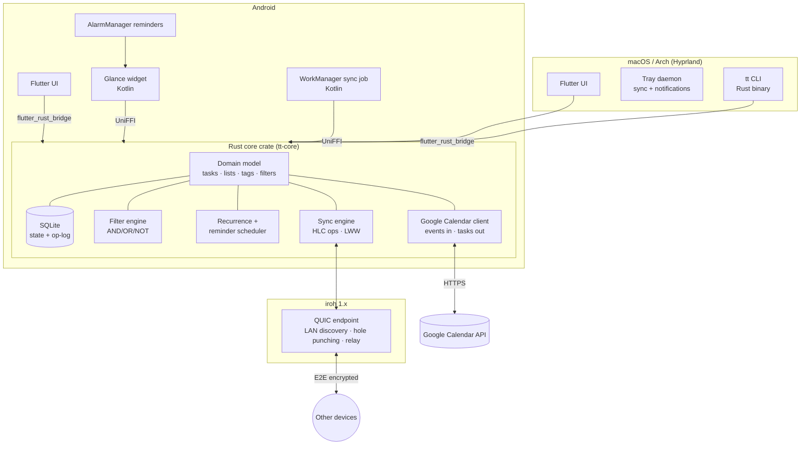

# 03 Architecture

Back to [[00 Overview]]. This assumes **Option A** from [[02 Tech Stack Options]]. Under Option B only the "UI" boxes change.

## Component diagram



## Repository layout (monorepo)

```
tick-alt/
  core/            # Rust: tt-core (lib). Domain, SQLite, filters, recurrence, sync, gcal
  core-ffi/        # Rust: UniFFI + flutter_rust_bridge surfaces
  cli/             # Rust: `tt` binary (talks to the same DB, or to the running daemon over IPC)
  app/             # Flutter app (android, macos, linux targets)
  android-widget/  # Kotlin Glance widget + WorkManager + alarms (inside app/android)
  docs/plan/       # these notes
```

## Key design rules

1. **The core owns all writes.**
   - UIs, the widget and the CLI call core commands such as `create_task`, `complete_task` and `set_tags`.
   - Each command produces **ops** (see [[05 P2P Sync]]) and updates the materialised SQLite tables in one transaction.
   - Nothing else writes to SQLite directly.
2. **Reads are queries.**
   - The UI subscribes to query streams: a filter id gives task rows, and a date range gives calendar items.
   - The core pushes change notifications, so every view stays live during sync.
3. **One process holds the database at a time, per device.**
   - On desktop, the tray daemon is the owner.
   - The UI and CLI connect to the daemon over a local socket. If no daemon is running, the CLI opens the DB directly (SQLite WAL plus a lock file).
   - On Android, everything runs in the same app process. The widget and WorkManager use the same DB with WAL.
4. **Platform services sit behind core traits.**
   - Notifications, secure token storage (Keychain, libsecret, Android Keystore) and network status are traits that each shell implements.

## Core modules

| Module | Responsibility |
|---|---|
| `model` | Task, List, Tag, Filter, ChecklistItem, Reminder, RepeatRule. Validation. |
| `store` | SQLite schema, migrations, materialised views, full-text search (FTS5) for the text filter. |
| `inbox` | Derives `in_inbox`. See [[04 Data Model#Inbox rule]]. |
| `filter` | Filter AST, evaluation, compiled to SQL where possible. |
| `recur` | RRULE subset and "after completion" mode. Generates the next instance on completion. |
| `remind` | Computes the upcoming reminder schedule. The shell registers OS notifications. |
| `sync` | HLC, op-log, peer state, sync protocol over iroh streams. |
| `pair` | Device identity (iroh key), QR pairing tickets, trusted peer list. |
| `gcal` | OAuth token handling (via platform trait), event pull, task push. |
| `import` | TickTick backup CSV importer. |

## Dependencies (to confirm versions at M0)
- `rusqlite` (bundled SQLite, FTS5)
- `iroh` 1.x
- `uhlc` or a hand-rolled HLC
- `rrule`
- `chrono` / `chrono-tz`
- `serde`
- `reqwest`
- `oauth2`
- `uniffi`
- `flutter_rust_bridge`
- `notify-rust` (Linux notifications to mako/dunst)
- `tray-icon` or Flutter `tray_manager`
