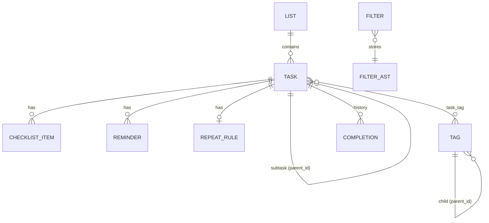

# 04 Data Model

Back to [[00 Overview]]. Sync-specific columns (HLC per field, tombstones) are covered in [[05 P2P Sync]].

## Entities



### Task
| Field | Type | Notes |
|---|---|---|
| `id` | UUIDv7 | Generated on the device. Sortable by creation time. |
| `title` | text | |
| `notes` | text | Stored as plain text. The detail pane renders it as Markdown (`app/lib/desk/markdown.dart`, no package: headings, bold/italic/strike, code, links, quotes, lists, `- [ ]` tasks that toggle the source). |
| `list_id` | UUID? | `NULL` means no list. |
| `parent_id` | UUID? | Subtask. Max depth 3 (TickTick allows 5, which is more than needed). Set from the detail's Parent picker (`Store::parent_candidates` lists the tasks that fit). |
| `priority` | 0–3 | none, low, med, high |
| `start_at`, `due_at` | timestamp? | With `all_day` bool and `tz` (IANA, or `floating` for all-day). |
| `duration_min` | int? | For calendar blocks. Defaults to 30 when dropped on the grid (decided 2026-11-25, [[18 M5 Calendar Log]]). |
| `status` | enum | `open`, `done`, `deleted` (Trash). |
| `completed_at` | timestamp? | |
| `sort_key` | text | Fractional index, for manual ordering inside a list or tag. |
| `created_at`, `updated_at` | timestamp | |
| `gcal_event_id` | text? | Deterministic. See [[06 Google Calendar]]. |
| `in_calendar` | bool | "Show in Calendar" (schema v6, 2026-11-25). On by default; off keeps the task off the calendar grid and its Unscheduled panel. |

### Checklist item
`id`, `task_id`, `title`, `done`, `sort_key`. These are lightweight: no dates, tags or reminders.

### Tag
| Field | Notes |
|---|---|
| `id`, `name` | `name` is unique among siblings. |
| `parent_id` | Nesting. Unlimited depth in the model, but the UI encourages 2–3 levels. |
| `color` | Hex |
| `icon` | Optional emoji or icon name |
| `sort_key` | Sidebar order among siblings (fractional index). Empty means never arranged: those come after the arranged ones, by name. |

- Display path is `parent/child`.
- Filtering on a tag **includes its descendants by default**. The filter builder offers an "exact" option to turn this off.
- Renaming or moving a tag is a single op, so tasks don't need rewriting because they reference the tag id.
- Arranging a tag (`Store::place_tag(id, before)`) writes one `sort_key` op: a base-36 key between its new neighbours (`core/src/order.rs`). The first arrangement of a set of siblings, or one that finds ties, numbers them all.
- Lists and filters are arranged the same way (`Store::place_list`, `place_filter`, v0.8.4), through the shared `place_among`. Their `sort_key` columns and `field_spec` entries already existed, so there is no schema change. Never-arranged ones sort after the arranged ones, by name.

### List
`id`, `name`, `color`, `icon`, `sort_key`, `archived`. Lists are flat: no folders, no sections.

### Repeat rule
- `freq`: daily, weekly, monthly or yearly.
- `interval`.
- `by_weekday[]`, `by_monthday`.
- `until` or `count`.
- `mode`: `fixed` (next date from the schedule) or `after_completion` (next date from the completion time).
- Stored as an RRULE string plus `mode`, using the `rrule` crate.
- **When you complete a repeating task:**
  1. A `COMPLETION` row is written, which is what the Completed list shows.
  2. The same task's dates advance to the next occurrence.
  3. Checklist items reset.
- The task keeps one stable id, which keeps the Google event mapping simple.

### Reminder
- `id`, `task_id`.
- `kind`: `relative` (offset minutes before start or due) or `absolute` (a timestamp).
- Each device schedules its own OS notifications from this data.

## Inbox rule

A task is **in Inbox** when **all** of these are true:
- `parent_id IS NULL` (top-level tasks only; subtasks follow their parent)
- `list_id IS NULL`
- it has **no tags**
- `start_at IS NULL AND due_at IS NULL`
- `status = open`

How it behaves:
- `in_inbox` is **derived, not stored**. It's computed in a SQL view, so it can never drift out of sync.
- Quick add, the widget's **+**, the CLI and imported untagged, undated, list-less tasks all land in Inbox naturally.
- **Removing** a task's last tag, its list and its dates puts it back in Inbox. That's intended.
- The Inbox count in the sidebar is the "to triage" number.

## Filters

A filter is a named, saved AST (stored as JSON) plus display options: sort, group and show-completed.

```json
{
  "name": "Today + Inbox",
  "icon": "☀️",
  "rule": {
    "any": [
      { "field": "inbox", "op": "is", "value": true },
      { "all": [
        { "field": "due", "op": "on_or_before", "value": "today" },
        { "not": { "field": "tag", "op": "has", "value": "weekend", "include_children": true } }
      ]}
    ]
  },
  "sort": ["priority_desc", "due_asc"],
  "group": "priority",
  "show_completed": false
}
```

**Fields**

| Field | Operators |
|---|---|
| `tag` | `has`, `has_any`, `has_all`, `has_none` (with `include_children`) |
| `list` | `is`, `is_not`, `none` |
| `inbox` | `is` |
| `priority` | `is`, `>=`, `<=` |
| `due` / `start` | `on`, `before`, `after`, `on_or_before`, `between`, `none`, `overdue` |
| `has_time`, `repeating` | `is` |
| `status` | `is` |
| `text` | `contains` (FTS5) |

- **Relative date tokens:** `today`, `tomorrow`, `+7d`, `this_week`, `next_week`, `this_month`. They're re-evaluated at midnight, which also refreshes the widget.
- **Builder UI:** nested groups toggle between "all of" and "any of", and each condition can be negated. A live preview count shows while you edit.
- The engine compiles to SQL `WHERE` clauses. The same AST is evaluated in Rust for tests and for the widget.
- **Adding a task in a filter view keeps it in the filter** (decided 2026-11-25). Quick add there gives the new task what the rule asks for, so it doesn't vanish (`core/src/filter/seed.rs`):
  - The rule is expanded into alternatives (`any` branches; `not` pushed down by De Morgan). The first one a fresh task can fully meet wins.
  - It sets the list, tags (the named tag itself; for `has_any`, the first that exists), the lowest allowed priority, and all-day due/start dates: today if allowed, else the nearest allowed day.
  - A new task can't have a time, a repeat, a done status, or text its title lacks. If no alternative can be met, the first one is applied as far as it goes.

## Built-in views
- **Inbox**: the rule above.
- **Completed**: `status = done`, plus repeat completions, newest first.
- **Trash**: `status = deleted`. Restore or purge. Auto-purge after N days is configurable, default 30.
- **List** views and **Tag** views: list, group and sort options. Sort (2026-11-25, v0.5.1): **one sort per device** for every view, in `meta.sort` (never synced); v7's `list.sort`/`tag.sort` and `filter.sort` are kept but unused. Manual order is the task's `sort_key` (`Store::place_task`), see plan/15 "Sorting views".
